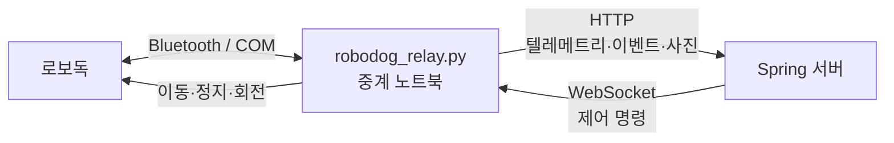

# SaveDog Relay

로보독의 블루투스 통신을 HTTP/WebSocket 기반 서버 통신으로 변환하는 Windows용 Python 중계 프로그램입니다.

로보독은 서버에 직접 접속하지 않습니다. 이 프로그램을 로보독과 블루투스 동글이 연결된 노트북에서 실행하면, 로봇의 센서·QR·위험 정보를 서버로 전달하고 서버의 제어 명령을 다시 로봇에 전달합니다.



## 주요 기능

- 로보독 연결과 이동·정지·회전·경고음 제어
- 서버 WebSocket 명령 수신 및 실행 결과 전송
- QR 코드 기반 이동 및 위험 처리
- 거리·기울기 센서 기반 위험도 판정
- 연속 위험 감지 시 자동 정지 및 이동 잠금
- 로봇 상태·속도·센서값·위험도 텔레메트리 전송
- 위험 상황 사진과 신고 후보 데이터 전송
- 통신 끊김 시 안전 정지 및 자동 재연결
- 카메라·로봇 SDK 접근 동기화

> 이 프로젝트는 위험 정보를 자체 서버에 **신고 후보**로 전달합니다. 국민신문고 등 정부 기관에 실제 민원을 자동 제출하지 않습니다. 실제 신고가 필요한 경우 보호자가 사진과 위치를 검토하고 승인하는 절차를 별도로 구현해야 합니다.

## 실행 구조

중계 프로그램과 Spring 서버는 같은 노트북에서 실행해도 됩니다.

```text
로보독 ← Bluetooth → 중계 프로그램 ← localhost → Spring 서버
```

서버가 다른 PC나 클라우드에 있다면 `ROBODOG_SERVER`에 해당 서버 주소를 지정합니다.

## 요구 사항

- Windows 노트북 또는 PC
- Python 3
- 로보독 및 블루투스 동글
- 카메라(위험 사진 기능을 사용하는 경우)
- 실행 중인 Spring 서버
- Python 패키지
  - `kocoafab_robodog`
  - `websockets` 11 이상
  - `opencv-python`(사진 기능을 사용하는 경우)

설치된 Python 환경에서 다음 명령으로 의존성을 확인할 수 있습니다.

```powershell
python -c "import kocoafab_robodog, websockets, cv2; print('라이브러리 준비 완료')"
```

필요한 공개 패키지는 다음과 같이 설치합니다.

```powershell
python -m pip install "websockets>=11" opencv-python
```

`kocoafab_robodog`는 로보독 SDK 배포 파일이나 제조사 안내에 따라 같은 Python 환경에 설치해야 합니다.

## 빠른 실행

### 1. 장비 연결

로보독 전원, 블루투스 동글, 카메라를 중계 노트북에 연결합니다. 사용 가능한 COM 포트는 PowerShell에서 확인할 수 있습니다.

```powershell
[System.IO.Ports.SerialPort]::GetPortNames()
```

### 2. 서버 실행

Spring 서버를 먼저 실행합니다. 서버와 중계 프로그램을 같은 노트북에서 실행한다면 기본 주소는 `localhost:8080`입니다.

### 3. 환경변수 설정

PowerShell에서 저장소 폴더로 이동하고 실행 설정을 입력합니다.

```powershell
cd C:\Users\master\savedog--relay

$env:ROBODOG_SERVER="localhost:8080"
$env:ROBODOG_PORT="COM15"
$env:ROBODOG_ID="robodog-01"
$env:ROBODOG_DEFAULT_SPEED="15"
$env:ROBODOG_CAMERA_INDEX="0"
$env:ROBODOG_CAMERA_FPS="10"
```

서버가 다른 컴퓨터에서 실행 중이라면 `localhost` 대신 서버 컴퓨터의 IP 주소를 사용합니다. `http://`는 붙이지 않습니다.

```powershell
$env:ROBODOG_SERVER="192.168.0.10:8080"
```

서버가 장치 토큰 인증을 사용한다면 다음 설정을 추가합니다.

```powershell
$env:DEVICE_API_TOKEN="서버와 동일한 토큰"
```

### 4. 중계 프로그램 실행

```powershell
python .\robodog_relay.py
```

정상 실행 시 다음과 비슷한 로그가 표시됩니다.

```text
로보독에 연결했습니다.
QR 모드 응답: ...
서버 연결: ws://localhost:8080/ws/robot
카메라 스트리밍 연결: ws://localhost:8080/ws/camera/upload
텔레메트리 전송 정상
이벤트 전송 정상
```

종료할 때는 `Ctrl+C`를 누릅니다. 기존 `robodog.py`를 동시에 실행하면 같은 COM 포트를 두 프로그램이 사용하게 되므로 `robodog_relay.py`만 실행해야 합니다.

## 주요 환경변수

| 환경변수 | 기본값 | 설명 |
|---|---:|---|
| `ROBODOG_SERVER` | `localhost:8080` | 서버의 `호스트:포트`. `http://` 제외 |
| `ROBODOG_PORT` | 자동 선택 | 로보독 블루투스 COM 포트 |
| `ROBODOG_ID` | `robodog-01` | 서버에서 사용하는 로봇 식별자 |
| `DEVICE_API_TOKEN` | 없음 | 서버의 `X-Device-Token` 인증값 |
| `ROBODOG_DEFAULT_SPEED` | `50` | 기본 이동·회전 속도(0~100) |
| `ROBODOG_LEG_BEND` | `60` | 시작 시 다리 굽힘 값(0~100) |
| `ROBODOG_CAMERA_INDEX` | `0` | OpenCV 카메라 번호 |
| `ROBODOG_CAMERA_JPEG_QUALITY` | `70` | 실시간 프레임 JPEG 품질(1~100) |
| `ROBODOG_CAMERA_FPS` | `10` | 카메라 전송 FPS(최대 30) |
| `ROBODOG_CAMERA_WIDTH` | `640` | 전송 프레임 너비 |
| `ROBODOG_CAMERA_HEIGHT` | `480` | 전송 프레임 높이 |
| `ROBODOG_DISTANCE_WARNING_CM` | `50` | 거리 경고 기준(cm) |
| `ROBODOG_DISTANCE_DANGER_CM` | `20` | 거리 위험 기준(cm) |
| `ROBODOG_TILT_WARNING_DEG` | `15` | 기울기 경고 기준(도) |
| `ROBODOG_TILT_DANGER_DEG` | `30` | 기울기 위험 기준(도) |
| `ROBODOG_DANGER_CONFIRM_COUNT` | `3` | 자동 정지 전 연속 위험 감지 횟수 |
| `ROBODOG_SAFETY_INTERVAL` | `0.05` | 안전 센서 확인 간격(초) |
| `ROBODOG_TILT_INTERVAL` | `1.0` | 텔레메트리 전송 간격(초) |
| `ROBODOG_RECONNECT_SECONDS` | `5.0` | 서버 재연결 대기 시간(초) |
| `ROBODOG_BARK_COOLDOWN` | `5.0` | 경고음 최소 간격(초) |

처음 실제 장비를 시험할 때는 `ROBODOG_DEFAULT_SPEED=15`처럼 낮은 값으로 시작하는 것을 권장합니다.

### 서버 경로 재정의

기본 서버 경로가 다른 경우 다음 환경변수로 전체 URL을 재정의할 수 있습니다.

| 환경변수 | 기본 경로 |
|---|---|
| `ROBODOG_TELEMETRY_URL` | `http://<SERVER>/api/robot/telemetry` |
| `ROBODOG_EVENT_URL` | `http://<SERVER>/api/robot/events` |
| `ROBODOG_HAZARD_URL` | `http://<SERVER>/api/robot/hazards` |
| `ROBODOG_WS_URL` | `ws://<SERVER>/ws/robot` |
| `ROBODOG_CAMERA_URL` | 미설정(선택 기능) |
| `ROBODOG_CAMERA_WS_URL` | `ws://<SERVER>/ws/camera/upload` |

## 서버 인터페이스

| 방향 | 방식 | 기본 경로 | 용도 |
|---|---|---|---|
| 중계 → 서버 | HTTP POST | `/api/robot/telemetry` | 센서값·상태·위험도 전송 |
| 중계 → 서버 | HTTP POST | `/api/robot/events` | QR·명령·안전 이벤트 전송 |
| 중계 → 서버 | HTTP multipart POST | `/api/robot/hazards` | 위험 사진과 신고 후보 생성 |
| 중계 → 서버 | WebSocket binary | `/ws/camera/upload` | 10 FPS JPEG 카메라 프레임 전송 |
| 서버 → 중계 | WebSocket | `/ws/robot` | 로봇 제어 명령 전송 |

WebSocket 명령은 JSON 객체로 전송합니다.

```json
{
  "commandId": "command-001",
  "type": "FORWARD",
  "speed": 15,
  "durationMs": 2000
}
```

지원 명령:

- `STOP`
- `EMERGENCY_STOP`
- `RESUME`
- `BARK`
- `FORWARD`
- `BACKWARD`
- `TURN_LEFT`
- `TURN_RIGHT`

`speed` 범위는 0~100이며, `durationMs`를 생략하면 다음 정지 명령까지 동작을 유지합니다. 회전 명령에는 0보다 크고 360 이하인 `degrees`를 지정할 수 있습니다.

## QR 동작

| QR 문자열 | 동작 |
|---|---|
| `start` | 전진 |
| `stop` | 비상정지 및 이동 잠금 |
| `resume` | 안전 확인 후 잠금 해제·전진 |
| `left` | 정지·좌회전·전진 |
| `right` | 정지·우회전·전진 |
| `warning` | 비상정지·경고음·위험 신고 후보 생성 |
| `fire` | 비상정지·경고음·화재 신고 후보 생성 |
| `ground` | 비상정지·경고음·노면 위험 신고 후보 생성 |
| `reroute` | 정지 및 우회 상태 전환 |
| `cross` | 횡단보도 대기 정지 |
| `arrive` | 비상정지 및 도착 상태 전환 |
| `report` | 수동 신고 후보 생성 |

## 안전 동작

다음 조건이 설정된 횟수만큼 연속 감지되면 로봇을 정지하고 이동을 잠급니다.

- 장애물 거리가 `ROBODOG_DISTANCE_DANGER_CM` 이하
- 기울기의 절댓값이 `ROBODOG_TILT_DANGER_DEG` 이상

위험 상태에서는 서버나 QR이 이동 명령을 보내도 거부됩니다. 센서값이 정상 범위로 돌아온 뒤 `RESUME` 명령을 받아야 다시 이동합니다. `arrive` 상태에서는 프로그램을 재시작하기 전까지 이동 명령을 거부합니다.

> 소프트웨어 정지는 PC와 Python 프로세스가 정상 동작할 때만 보장됩니다. PC 전원 차단이나 프로세스 강제 종료에도 안전을 확보하려면 로봇 펌웨어 차원의 명령 타임아웃 또는 watchdog이 필요합니다.

## 문제 해결

### 로보독 연결 실패

- 로보독 전원과 블루투스 동글 연결을 확인합니다.
- `ROBODOG_PORT`가 실제 COM 포트와 같은지 확인합니다.
- 다른 `robodog.py`나 시리얼 프로그램이 COM 포트를 사용 중인지 확인합니다.

### `ModuleNotFoundError`

패키지를 설치한 Python과 프로그램을 실행하는 Python이 같은지 확인합니다. Thonny를 사용한다면 Thonny의 인터프리터에 패키지를 설치해야 합니다.

### 서버 연결 실패

- 서버를 먼저 실행했는지 확인합니다.
- 다른 PC의 서버라면 IP 주소와 포트, Windows 방화벽을 확인합니다.
- `ROBODOG_SERVER`에는 `http://`를 붙이지 않습니다.

```powershell
Test-NetConnection 192.168.0.10 -Port 8080
```

### HTTP 400·404·500 오류

Spring 서버의 요청 DTO와 경로가 위 인터페이스와 일치하는지 확인합니다. 해당 오류는 로봇 연결 문제가 아니라 서버 API 형식 또는 서버 내부 처리 문제입니다.

## 파일 구성

```text
SaveDog--relay/
├─ robodog_relay.py  # 로봇 제어·안전 감시·서버 중계 통합 프로그램
└─ README.md         # 프로젝트 설명과 실행 안내
```

## 신고 기능 범위

현재 프로그램은 위험 감지 시 자체 서버에 사진과 센서 정보를 보내 신고 후보를 생성합니다. 정확한 GPS 위치 결합, 보호자 승인·거절 화면, 실제 기관 접수는 서버 또는 보호자 애플리케이션에서 별도로 구현해야 합니다. 오탐으로 인한 오신고를 방지하기 위해 실제 외부 신고 전에는 사람의 검토 단계를 유지하는 것을 권장합니다.
